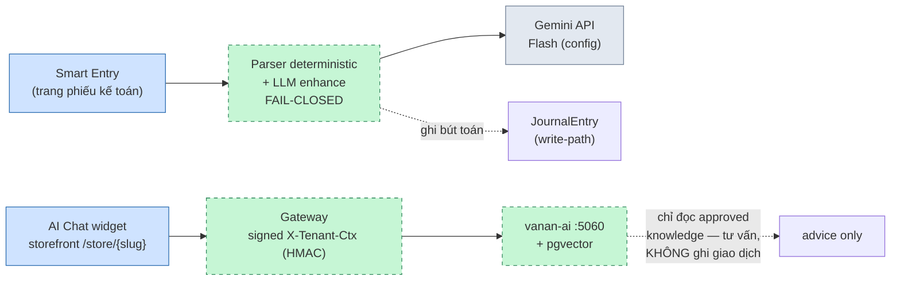
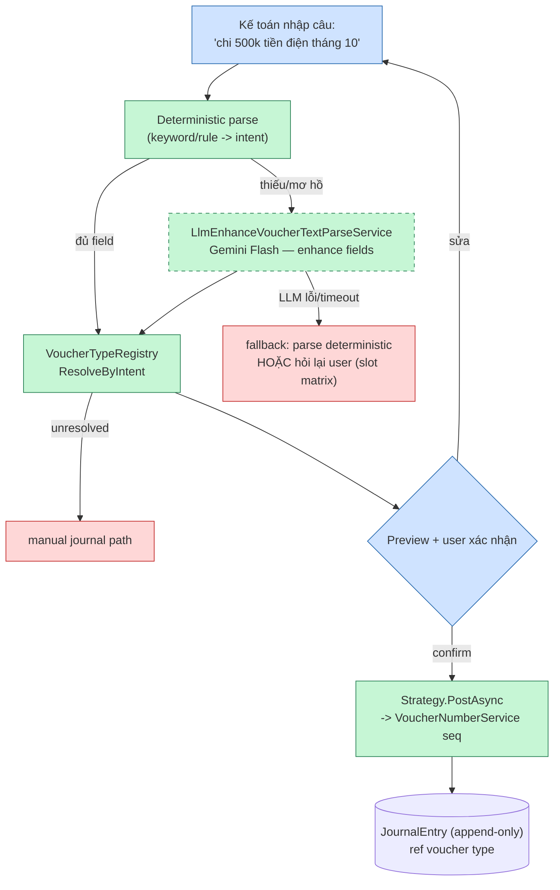
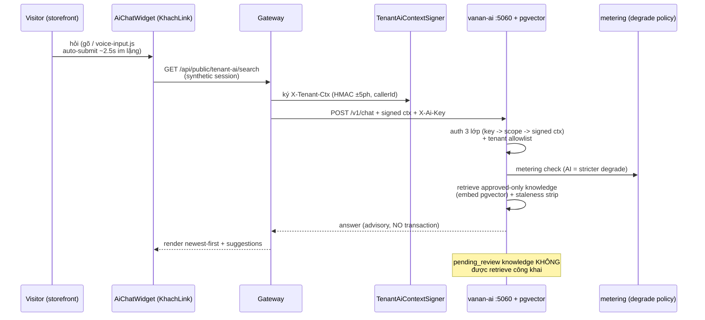
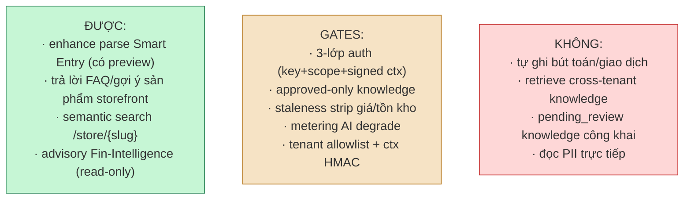

# AI/LLM — Smart Entry (kế toán) + Chat widget (storefront)

> Hai luồng LLM độc lập. Verified @476cd73f (2026-11-08).

## 1. Tổng quan — 2 đường LLM, ranh giới khác nhau

## 2. Smart Entry — text tự nhiên -> bút toán (fail-closed)

**Nguyên tắc:** LLM chỉ *enhance* parse — không được tự ghi; deterministic fallback luôn sẵn sàng (fail-closed); user luôn preview trước khi post.

## 3. Storefront AI Chat — widget -> signed ctx -> vanan-ai

## 4. Ranh giới AI — cái AI ĐƯỢC và KHÔNG ĐƯỢC làm

## Ghi chú giao tiếp chính

- **Smart Entry:** LLM = bước *tăng cường* giữa deterministic parse và `ResolveByIntent` — không thay thế registry/strategy; LLM fail → fallback deterministic (fail-closed), không fail-open.
- **Chat widget:** search endpoint nhân tạo session → cùng `/v1/chat`; ctx HMAC ±5ph + callerId match + tenant allowlist (3 lớp); widget anonymous nhưng request do Gateway ký — tenant nào ctx đó, không leo quyền.
- **Knowledge boundary:** chỉ `approved` knowledge được retrieve; `pending_review` cần approve trước; staleness stripping gỡ claim volatile (giá/tồn) trước khi trả lời.
- **Metering:** AI có degrade policy chặt hơn caller thường (quota → degrade trước deny).
- **Voice input:** `window.vananVoiceInput` (vi-VN, interim+silence auto-final, `Voice_Note_Enabled` gate) — transcript vào cùng text path.
