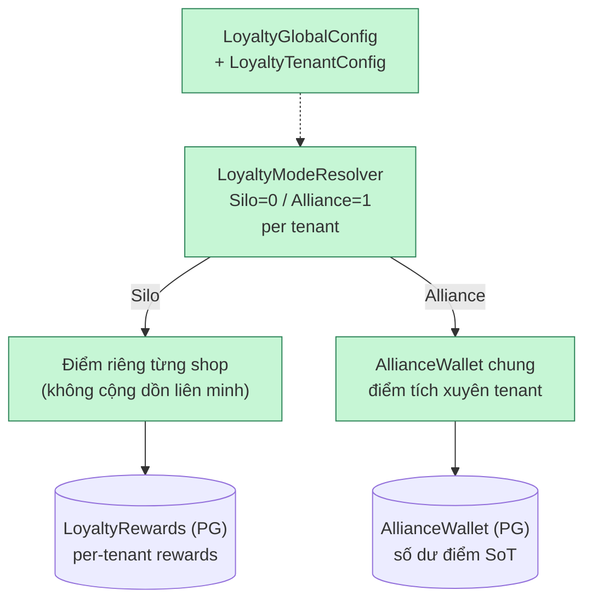
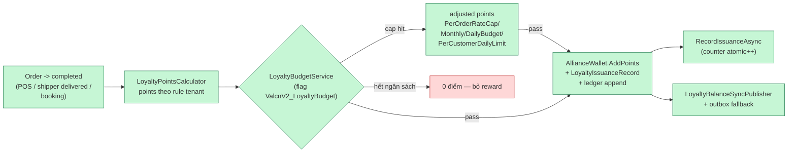
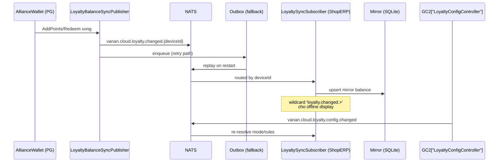
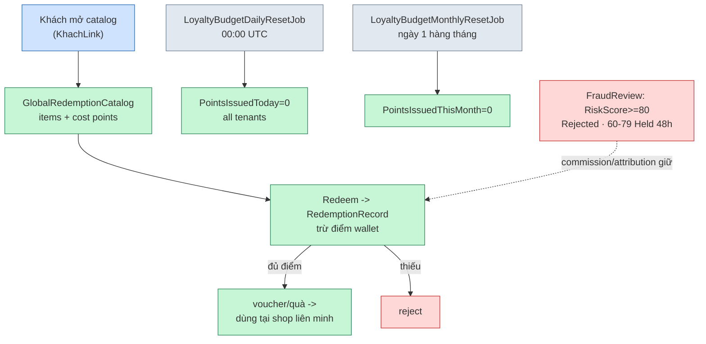

# Điểm thưởng liên minh — Loyalty Alliance

> Chi tiết luồng accrual/sync/redemption/budget. Verified @476cd73f (2026-11-08).
> SoT: PG (AllianceWallet + LoyaltyRewards + ledger). SQLite = mirror cho display.

## 1. Tổng quan — 2 chế độ Silo vs Alliance

## 2. Accrual — đơn hàng sinh điểm

## 3. Sync PG -> SQLite (display mirror)

## 4. Redemption + budget reset + jobs

## Ghi chú giao tiếp chính

- **Trigger accrual:** order `completed` (từ POS hoặc shipper `DeliveryTask` → `OrderWorkflowService`) — points tính theo rule tenant, KHÔNG ghi trực tiếp khi order tạo.
- **Budget (VALCN v2 P3, flag OFF mặc định):** `LoyaltyBudgetService` check 4 caps trước `AddPoints` → adjusted (có thể thấp hơn hoặc 0); `RecordIssuanceAsync` atomic counter; reversal path (Phase 4) decrement. `RecordIssuance` fail chỉ warn — counter có thể lệch nhẹ (by design).
- **Sync:** publish `loyalty.changed.{deviceId}` routed + **outbox fallback** khi publish fail; ShopERP mirror subscribe wildcard `loyalty.changed.>`; config đổi → `loyalty.config.changed` broadcast.
- **Idempotency:** `LoyaltyIssuanceRecord` chống double-issue (orderId tracking); outbox replay không cộng trùng.
- **Reconcile:** `LoyaltyReconcileCase` entity tồn tại cho tra soát điểm (drift backlog).
- **Commission link:** salesman commission/attribution qua `FraudReview` — Rejected (score≥80) / Held (60-79, 48h) trước khi chi.
