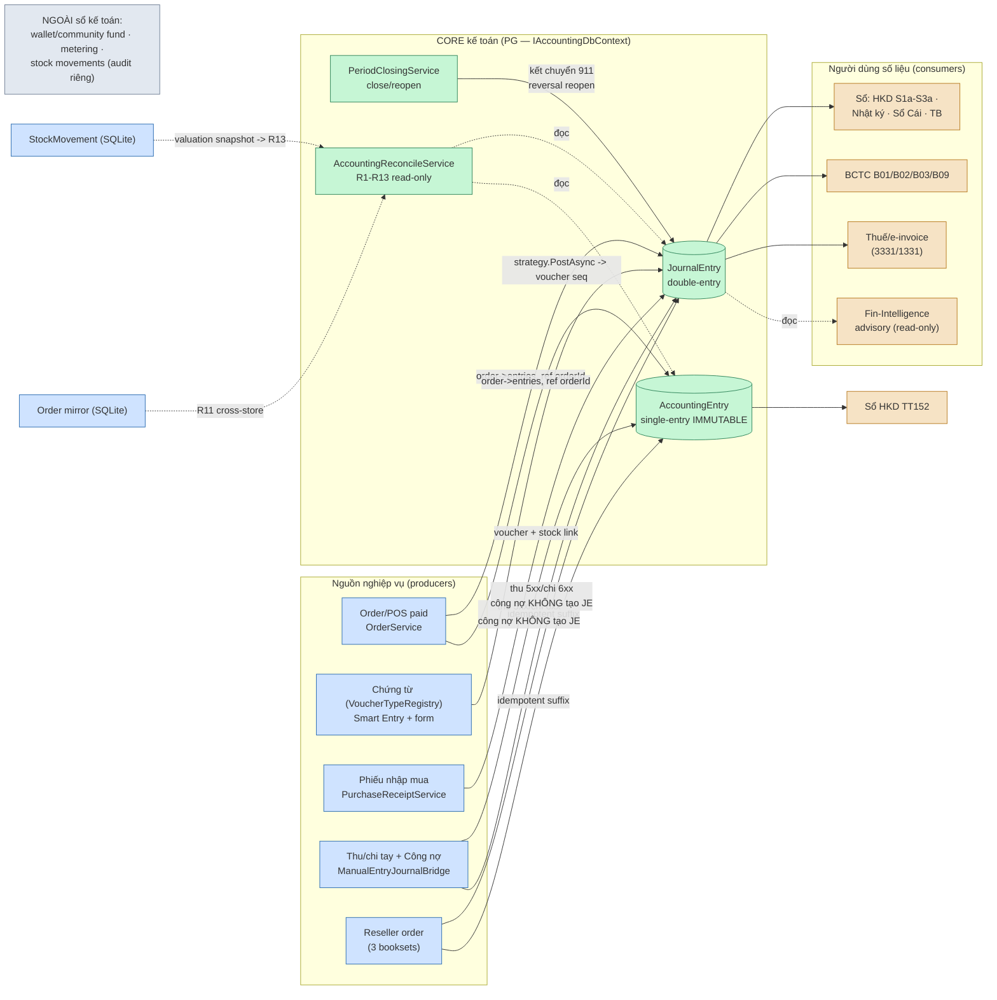
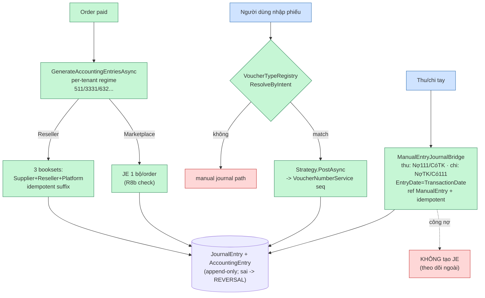
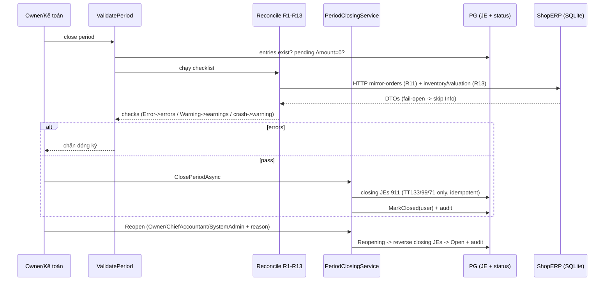
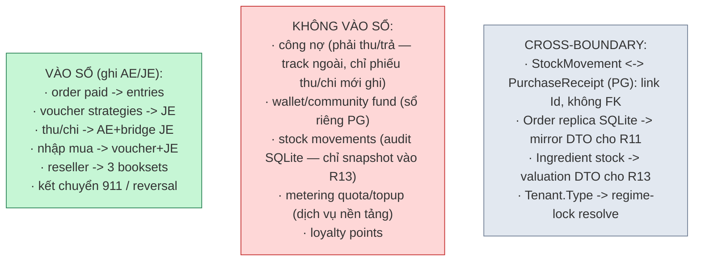

# Kế toán — Luồng chi tiết & giao tiếp module

> Chi tiết hóa sơ đồ #5 từ `van-hanh-he-thong.md`. Verified @476cd73f (2026-11-08).

## 1. Bản đồ tích hợp — ai ghi vào kế toán, ai đọc ra

## 2. Write-path — nghiệp vụ thành bút toán

## 3. Chu kỳ kỳ kế toán — close/reconcile/reopen

## 4. Ranh giới module — cái GÌ đi vào sổ, cái gì KHÔNG

## Ghi chú giao tiếp chính

- **Order → kế toán:** `OrderService.GenerateAccountingEntriesAsync` — 1 journal/paid order (R8b); đường journal trực tiếp `ref 'Order'` đã bỏ từ **2026-10-29** (R8a bridge) — mọi ghi mới đi qua bút toán chuẩn.
- **Voucher framework:** mọi chứng từ mới = `VoucherTypeDefinition` + `IVoucherPostingStrategy` — Smart Entry resolve theo intent, không hardcode route.
- **Công nợ:** phải thu/trả **không** tạo JE — chỉ theo dõi 131/331 qua entries + phiếu thu/chi.
- **Immutable:** `AccountingEntry` append-only — mọi sửa sai = reversal entry; `JournalEntry` cũng chỉ chỉnh qua reversal/close-reopen.
- **Regime-lock:** `AccountingStandardRules` quyết định sổ nào áp dụng (HKD→TT152 sổ riêng, không BCTC trừ khi elect TT58).
- **Kho ↔ GL:** stock không ghi bút toán — chỉ snapshot `Σ(stock×price)` nuôi check R13; nếu cần bút toán nhập kho → qua phiếu nhập mua.
- **Reconcile:** SystemAdmin-only, read-only, audit-log mỗi lần chạy; fail-open (R11/R13 skip Info khi provider lỗi).
