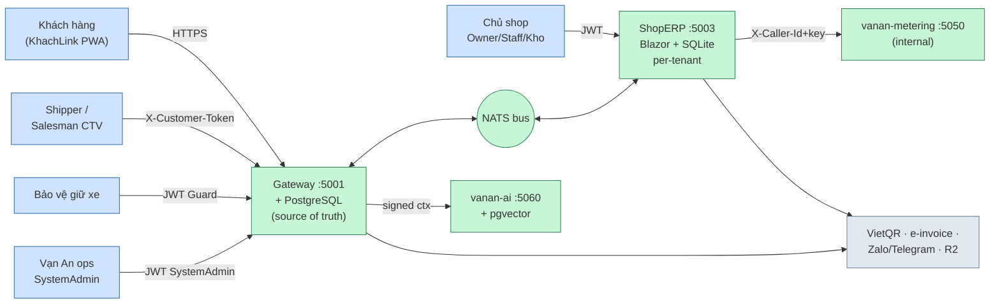
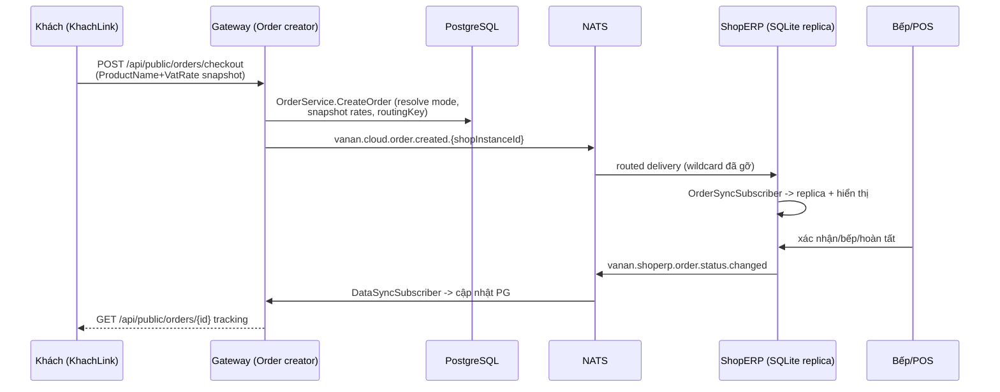
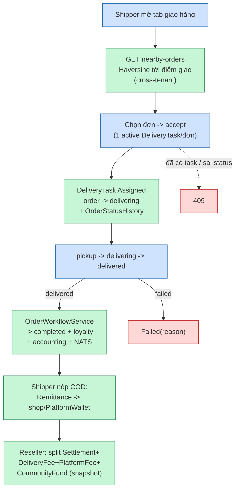
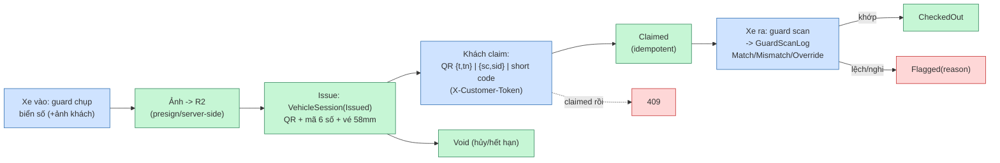
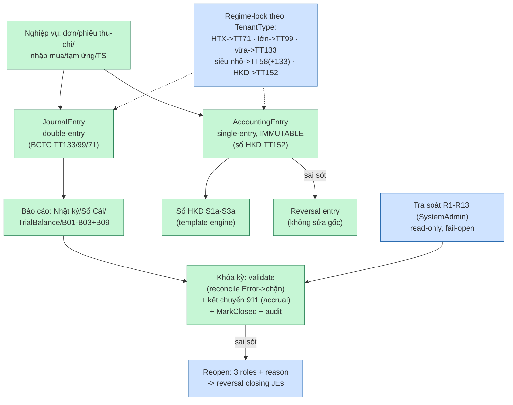
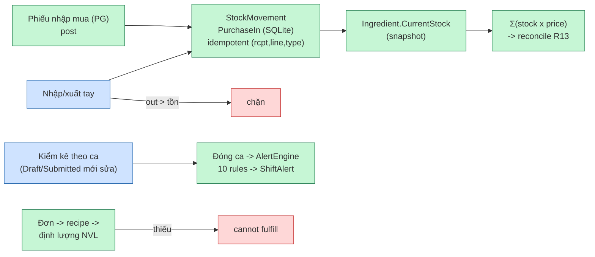
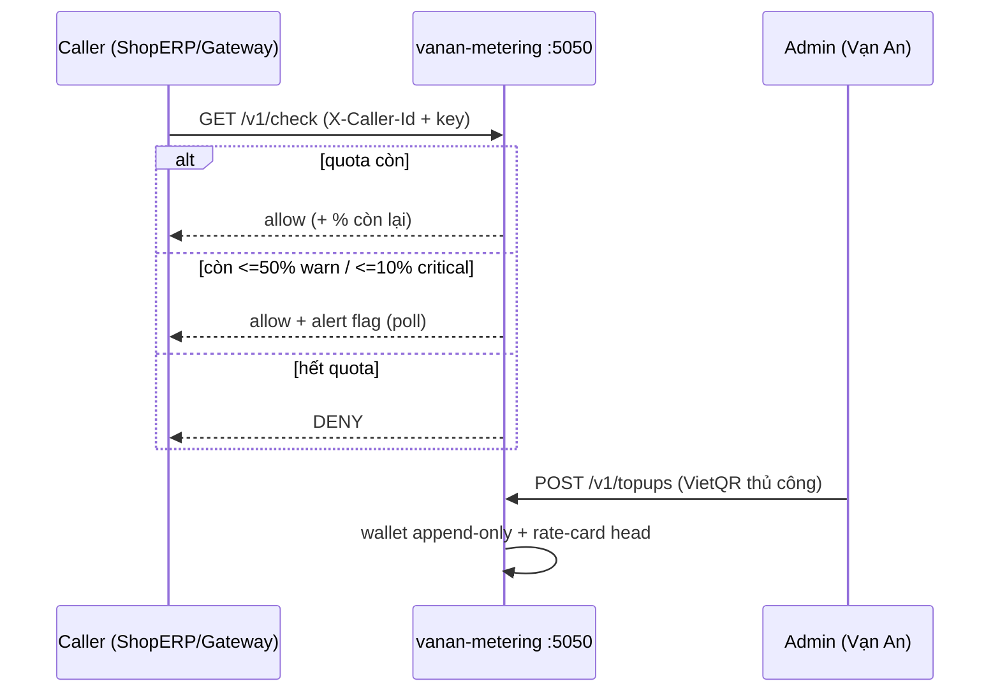
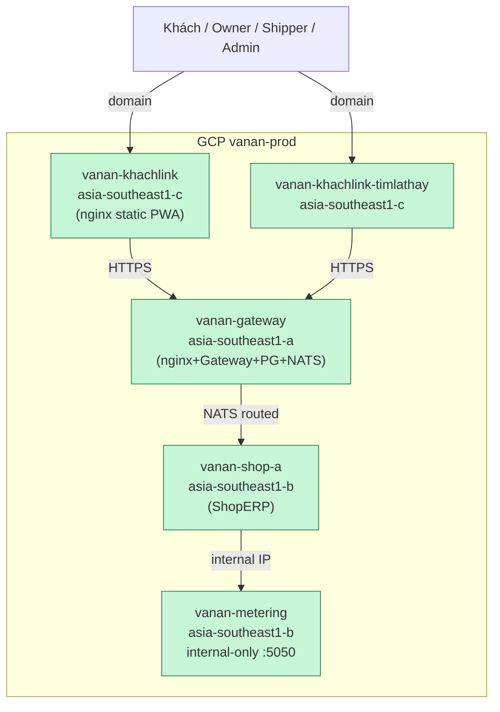

# Vạn An — Sơ đồ vận hành hệ thống

> Sơ đồ minh họa cách hệ thống vận hành thực tế (không phải digital-twin registry).
> Mermaid — xem trên GitHub/VS Code, hoặc mở `van-hanh-he-thong.html` cùng thư mục.
> Verify tại `476cd73f` (2026-11-08).

## 1. Bối cảnh hệ sinh thái

## 2. Xương sống đơn hàng (Option C — PG là SoT)

## 3. Giao hàng cộng đồng — VALCN shipper

## 4. Giữ xe — QR Parking

## 5. Kế toán — 2 sổ song song theo regime

## 6. Tồn kho — voucher PG ↔ stock SQLite

## 7. Phí nền tảng — metering deny gate

## 8. Triển khai — multi-VPS

