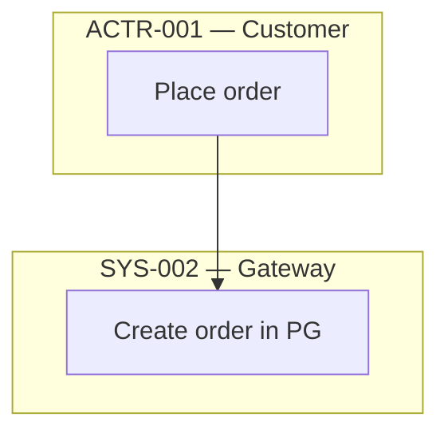

# Diagram Conventions — Vạn An Enterprise Operating Model

> Normative reference for ALL diagrams in this twin. SRS v2.1 §5.3, §6.2, §6.4, §9.1.
> Mermaid must render (AC-11). Never mix conventions within one diagram.

## 1. Execution-type colors (SRS §5.3 — mandatory classDef)

Copy this block into every flowchart/swimlane:

```mermaid
flowchart TB
    classDef human fill:#cfe3ff,stroke:#2b6cb0,color:#1a365d
    classDef auto fill:#c6f6d5,stroke:#2f855a,color:#22543d
    classDef hybrid fill:#feebc8,stroke:#c05621,color:#7b341e
    classDef external fill:#e2e8f0,stroke:#718096,color:#2d3748
    classDef error fill:#fed7d7,stroke:#c53030,color:#742a2a
    classDef ai fill:#c6f6d5,stroke:#2f855a,stroke-dasharray:5 5,color:#22543d
```

| Type | Color | classDef | Meaning |
|---|---|---|---|
| Human activities | Blue | `human` | One human performs one action |
| Automated | Green | `auto` | System performs, no human in that step |
| Hybrid | Amber | `hybrid` | ONE atomic step, inseparable human+software output (rare — see §3) |
| External systems | Grey | `external` | Third-party/government |
| Errors/exceptions | Red | `error` | Failure, blocked, rejected paths |
| AI agents | Green + dashed | `ai` | Advisory AI (vanan-ai, LLM parsers) — see §5 boundary |

## 2. Diagram types — distinct questions (SRS §6.2)

| Diagram | Question | When required |
|---|---|---|
| Swimlane flowchart | Who does what / where responsibility sits | **Mandatory** for every critical process (§6.5) |
| Flowchart (no lanes) | Sequence of steps/decisions | Any workflow |
| Sequence diagram | Technical interaction over time | API/NATS/service handoffs — complements, never replaces swimlanes |

### Swimlane rule (Mermaid has no native swimlanes)



- One `subgraph` per lane; lane title = `ID — name`; each subgraph `direction TB`.
- Cross-lane edges = handoffs. Only participating actors get lanes.
- If a critical flow needs both views, produce swimlane + sequenceDiagram as two linked artifacts sharing `ACTV-`/`API-` IDs.

## 3. Execution classification — decompose-first (SRS §5.1)

Before assigning HYBRID, split into MANUAL + AUTOMATED activities joined by a handoff/approval gate. HYBRID is correct ONLY for a single atomic step where human and software co-produce one output (e.g., Smart Entry interactive parsing). "Software detects → human reviews" is TWO activities, not HYBRID.

## 4. Flowchart completeness (SRS §6.3)

Every workflow must show: start/end events, triggers, human+automated+hybrid actions, decisions, data in/out, approval gates, exception/error paths, external dependencies, handoffs, responsible parties. Happy-path-only is insufficient.

## 5. AI actors (SRS §7.4)

AI activities use classDef `ai` and must state: advisory vs executing, authoritative data source, tenant isolation scope, metering link.

## 6. Evidence format (SRS §9.1 — mandatory on every AS-IS claim)

```
<repo-relative-path>@<commit-sha>     preferred — e.g. 2_Gateway/Controllers/OrdersController.cs@64789992
<repo-relative-path>#L<start>-<end>   fallback when commit impractical (line refs decay — note it)
none:<reason>                         explicit no-evidence marker
```

Every evidence-register entry records the repo commit SHA at capture time. A claim that cannot be re-verified at HEAD is flagged `STALE` — never silently trusted.
