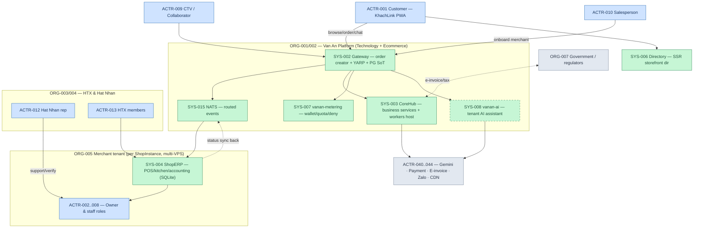

# Vạn An Ecosystem — Context Diagram (L0)

> Phase 1 output · captured at `64789992`. Actors/components referenced by registry ID.

## Reading guide

- **Option C data spine:** `Customer → Gateway (PG SoT) → NATS vanan.cloud.order.created.{shopInstanceId} → ShopERP` ; status sync returns via `vanan.shoperp.*`.
- **Tenant boundary:** each merchant = separate SQLite + ShopInstance routing entry; HTX = tenant class with HtxProfile + TT71 regime.
- **AI boundary (§7.4):** vanan-ai is advisory — suggests into existing flows; never creates orders/records; metered (`ai.chat.message`).
- Registry IDs on nodes are navigable: look up `SYS-004` in `registries/components.yaml`, `ACTR-002` in `registries/actors.yaml`.
