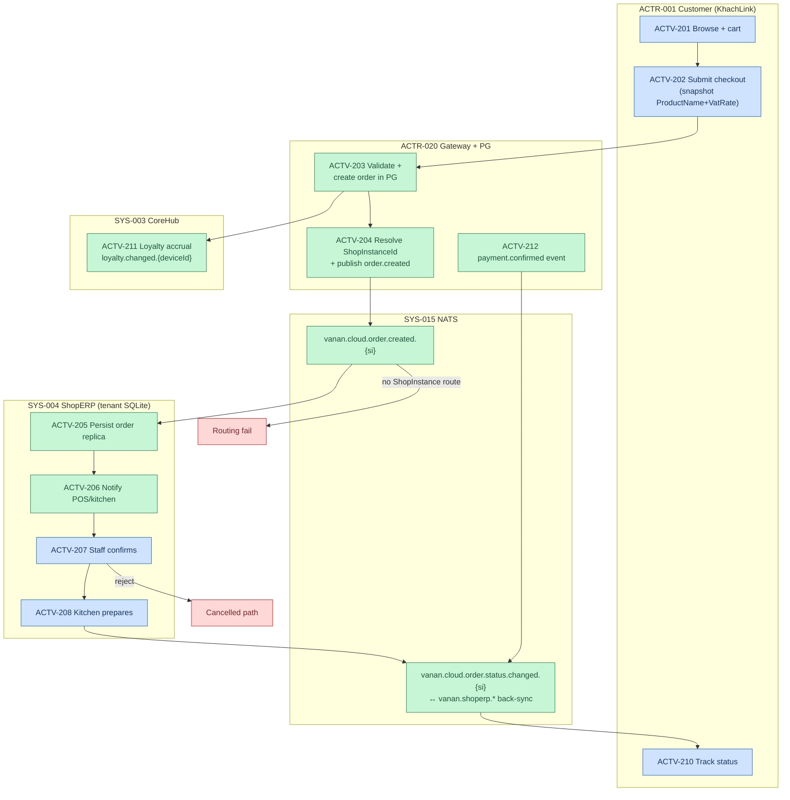
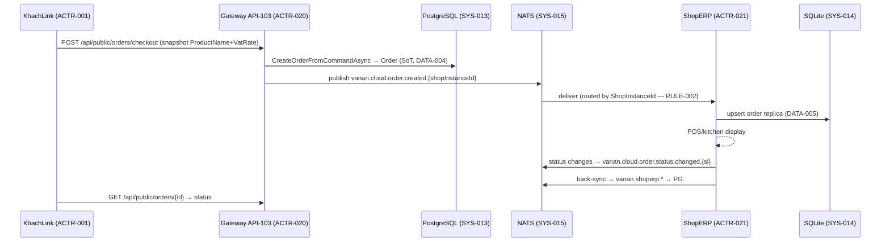

# F1 — Order Lifecycle AS-IS (Track B, Option C)

> Swimlane per SRS §6.2. Activities → `registries/activities.yaml` ACTV-201..212.
> Confidence: VERIFIED for system steps at `64789992`; INFERRED for staff UI actions.

## Sequence view (technical — complements swimlane, SRS §6.2 rule 3)

## Exception paths (SRS §6.3)

| Trigger | Path |
|---|---|
| Invalid checkout payload | 4xx — no order created |
| Missing ShopInstance route | order stays PG-only — routing fail (error, needs monitoring) |
| NATS down | outbox/retry pattern (VERIFIED pattern in code) |
| Duplicate event delivery | idempotent upsert in subscriber |
| Order rejected by shop | cancelled status → sync back |
| Payment confirmed later | separate event `payment.confirmed.{si}` |

## Boundaries

- **SoT:** Order lives in PG (DATA-004); ShopERP copy is replica for display (DATA-005). Status transitions originate at ShopERP → sync back (verified direction comments).
- **RULE-001:** Gateway never queries Products at checkout — client snapshot is authoritative for the order record.
