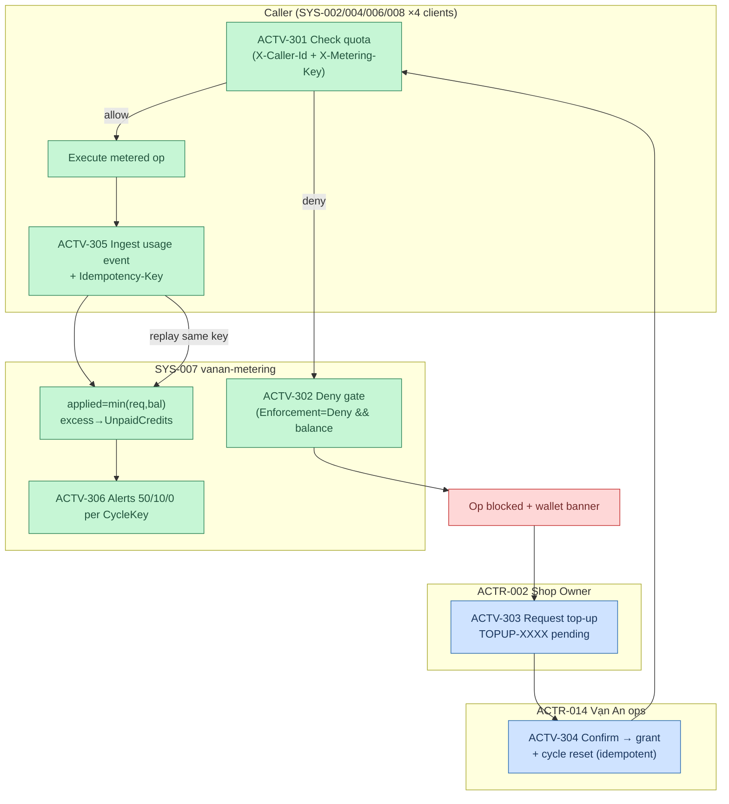

# F2 — Metering "Phí nền tảng" (AS-IS, X1)

> Activities → `registries/activities.yaml` ACTV-301..306. Rules: RULE-007..009. Controls: CTRL-003/011/012. `64789992`.

**Exception paths:** check fail → caller policy (fail-open default; vanan-ai degrade structured-only — GAP-014 by design) · replay idempotency → event cũ (CTRL-011) · double-confirm → unique partial index blocks (RULE-008) · Pending>72h → lazy Expired · unpriced serviceCode → no deduct.

**Critical points (§6.5: 1,4,5,6):** deduct trong CÙNG tx với event (RULE-009); ledger append-only (CTRL-012); deny gate là revenue gate.
