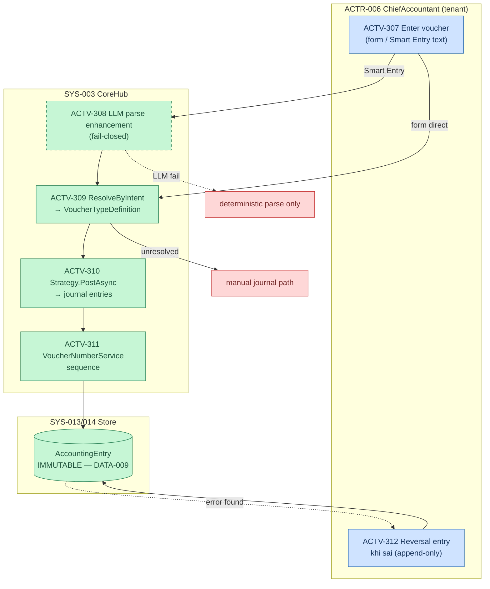

# F3 — Voucher Posting (AS-IS, X1)

> Activities → `registries/activities.yaml` ACTV-307..312. Rules: RULE-010..012. `64789992`.

**Strategies (verified, `VoucherFramework.cs`):** Advance · StockIssue · AssetDisposal · Loan · Depreciation · Deposit + ManualJournalVoucherService. New voucher type = `AddVoucherType(def, strategy, intents)` — RULE-010 cấm page copy-paste.

**Immutability (CTRL-001/013, RULE-012):** AccountingEntry append-only; sửa sai = reversal entry trong cùng pattern — original không bao giờ đổi.

**Critical (§6.5: 1,4,6):** financial record creation + approval/audit + tax exposure.
