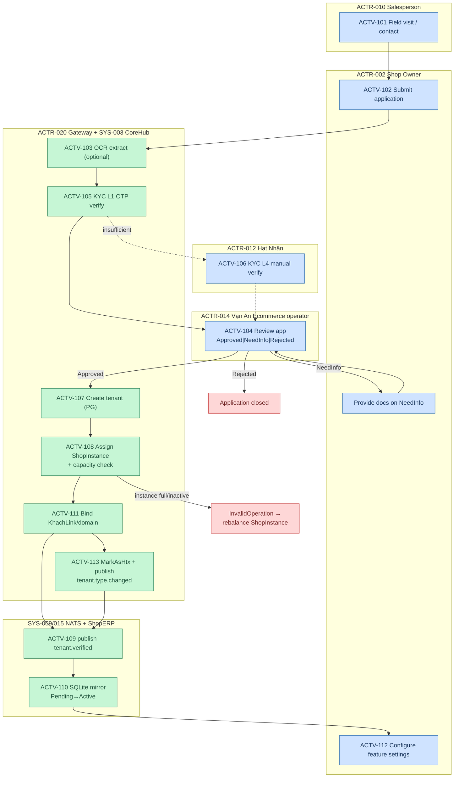

# F4 — Merchant Onboarding & Tenant Provisioning (AS-IS, Track A)

> Swimlane per SRS §6.2. Activities → `registries/activities.yaml` ACTV-101..115.
> Coverage: PARTIAL — human steps INFERRED (await Q3/Q4); system steps VERIFIED at `64789992`.

## Exception paths (SRS §6.3)

| Trigger | Path |
|---|---|
| Application Rejected | terminal — owner notified (mechanism TBD, INFERRED) |
| NeedInfo | loops back to owner for documents → re-review |
| ShopInstance full/inactive | `InvalidOperationException` — operator rebalances/assigns other instance (RULE-003) |
| NATS down at tenant.verified | outbox retry (pattern exists in codebase, confidence V) |
| OCR failure | manual entry fallback |
| Suspend/deactivate | ACTV-115 — blocks ops, reversible via reactivate |

## Variants (§6.6)

- Business-type differences (F&B vs spa vs retail) mostly = CONFIGURABLE via `TenantFeatureSettings` (ACTV-112), not process forks.
- `TenantType` (HKD vs Enterprise vs HTX) → VARIANT at accounting-regime level (RULE-004), not onboarding level.

## Open items (INFERRED — need owner, Q3/Q4)

- Who performs application review today — Ecommerce ops vs delegated HTX? (ACTV-104 marked ACTR-014, confidence V on workflow, I on actor)
- Is there a contract/signing step between approval and provisioning (not visible in code)?
- Hạt Nhân role at L4 verification — per membership SRS, not code-verified.
