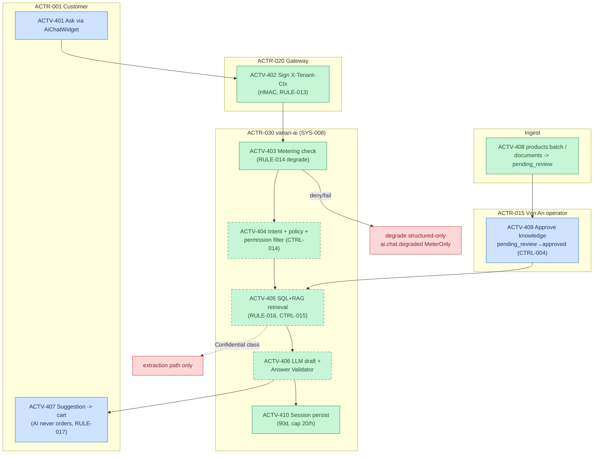

# F5 — Vạn An AI (`vanan-ai`) Deep Model (AS-IS, X3)

> Activities → `activities.yaml` ACTV-401..410 · Rules RULE-013..018 · Controls CTRL-004/005/014/015.
> Boundary §7.4 + AC-13: advisory-only, tenant-isolated, metered, approved-knowledge-only. `64789992`.

## AI boundary summary (AC-13 per activity)

| Activity | Advisory/Executing | Authoritative source | Isolation | Metering |
|---|---|---|---|---|
| ACTV-403 check | executing (gate) | metering service | caller+ctx | ai.chat.check |
| ACTV-404/405/406 | advisory generation | structured > vector (RULE-016) | signed ctx + approved-only | ai.chat.message |
| ACTV-407 cart | human executes | order flow F1 | — | — |
| ACTV-409 approval | human authority | knowledge registry | tenant scope | — |

## Governance (§10.2)

- Knowledge owner = **tenant**; infra owner = Vạn An; accountability for AI output follows whoever turns suggestion → action (RULE-017 keeps AI out of record creation).
- Quota = governance control (cost boundary), not just tech limit — degrade is deliberate policy (RULE-014), documented GAP-014.
- Verified endpoints: `/v1/chat`, `/v1/chat/sessions/{sid}/messages`, `/v1/config/widget`, `/v1/knowledge/*`, `/v1/admin/knowledge/{pending,approve}`, `/v1/auth/*` (`Program.cs`@64789992).
