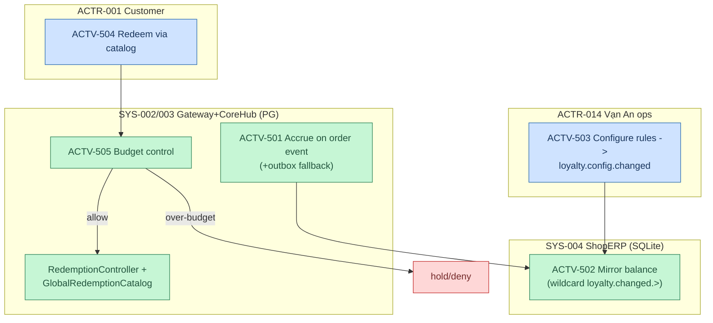

# F6 — Loyalty Accrual & Redemption (AS-IS, X2)

> Activities → `activities.yaml` ACTV-501..505 · RULE-019 · `64789992`.

**Notes:** points accrue AUTOMATED từ order events; mirror wildcard sub (`loyalty.changed.>`) cho offline display; budget semantics INFERRED (GAP-015 — verify sau). SoT: PG wallet/loyalty; SQLite = mirror.
