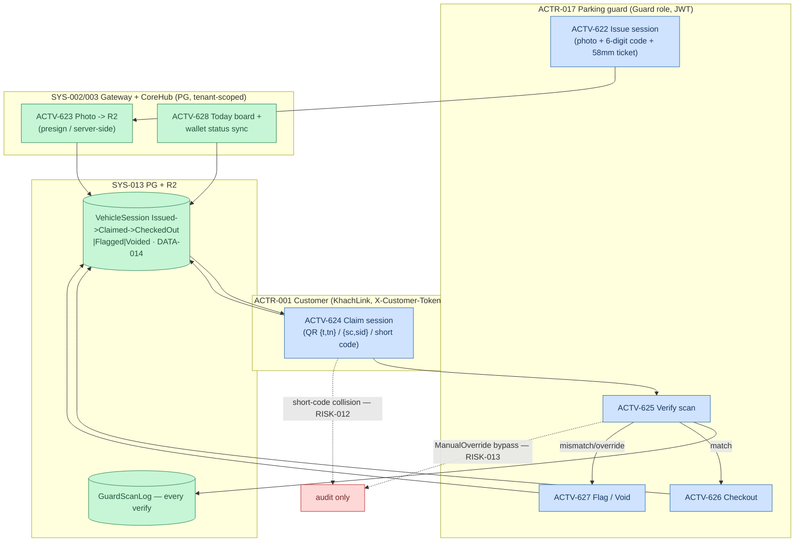

# Giữ xe — Guard QR Parking (AS-IS, D1 deep-dive addendum)

> Activities → `activities.yaml` ACTV-622..628 · PROC-184 · RULE-026..028 · CTRL-021/022 · RISK-012/013 · `4f3c7ea3`.
> Feature flag: `Guard:QrVerifyEnabled` (all endpoints 403 when off). Issue #126/#130/#147.

**Verification model (RULE-026):** photo + QR token = primary verifiers; plate number optional metadata; customer photo optional (#130). Raw QR token never stored — hash only (`QrTokenHash`, CTRL-021).

**Claim channels (ACTV-624):** A = KhachLink scan QR `{t,tn}` → tenant from payload · B = printed-ticket `{sc,sid}` → tenant via session lookup (#130-fix2) · C→A = 6-digit short code → tenant via first match (#147). Claim idempotent: only `Issued`, already-claimed → 409 (RULE-027).

**State machine (RULE-028):** `Checkout` from Issued|Claimed · `Flag` from Issued|Claimed (reason required) · `Void` never from CheckedOut.

**Audit (CTRL-022):** every verify writes `GuardScanLog` (Match/Mismatch/ManualOverride/Flagged) — ManualOverride is audit-only mitigation for checkout bypass (RISK-013).

**Exceptions:** feature flag off → 403 · unknown QR → 404 · wrong state → 409 · tenant unresolved from payload/sid/shortcode → 400.
