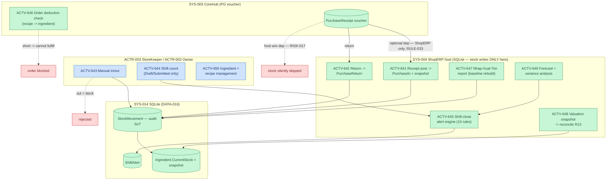

# Inventory — Stock · Count · Intelligence (AS-IS, D2 deep-dive)

> Activities → `activities.yaml` ACTV-641..650 · PROC-161..165 · RULE-033..036 · CTRL-026..028 · RISK-017..019 · `f447a1a8`.
> Store split: PurchaseReceipt = PG voucher · stock entities = **SQLITE_TENANT** (DATA-016) — link by Id only, no FK (RULE-036).

**Voucher link (RULE-033/036):** receipt post on PG → `ApplyReceiptStockAsync` (PurchaseIn + `CurrentStock` += + `PricePerUnit` = latest + `StockAppliedAt`); return → `ApplyReturnStockAsync` (negative allowed — consumed-before-return = RISK-018). Idempotent per (receiptId, lineId, type) — CTRL-026.

**Stock semantics (RULE-035):** `StockMovement` = audit SoT; `CurrentStock` snapshot only. Report baseline = `CurrentStock − Σmovements` → opening correct even for pre-table stock. Manual-out > stock → rejected; return may go negative.

**Count & alerts (RULE-034, CTRL-027):** `InventoryCount` editable only while shift Draft/Submitted (blocked after Closed, NFR-7); shift close → AlertEngine 10 rules (ING_VARIANCE_HIGH, STOCK_LOW…) → ShiftAlert in-app (+optional Telegram/Zalo — unseen risk RISK-019).

**Exceptions:** stock apply silently skipped on non-ShopERP hosts (RISK-017) · insufficient ingredient → order cannot fulfill · out > stock → InvalidOperationException · count edit after Closed → blocked · provider/HTTP fail → R13 skips Info.
