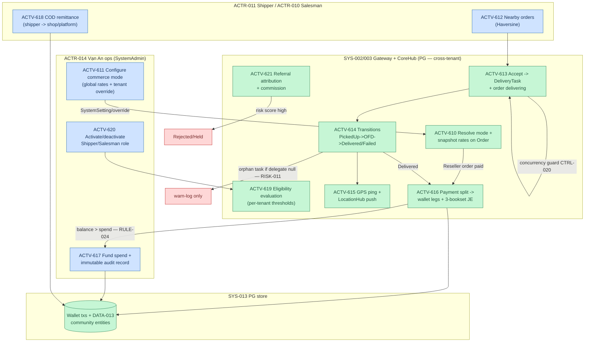

# VALCN — Community Commerce (AS-IS, D1 deep-dive)

> Activities → `activities.yaml` ACTV-610..621 (detail) · coverage anchors ACTV-606..608 · RULE-020..025 · CTRL-016..020 · RISK-007..011 · `69496de4`.

**Modes (RULE-020):** Marketplace (tenant sells direct) vs Reseller ("Mua giúp — Bán dùm": Vạn An buys from supplier, resells; margin splits into PlatformFee + CommunityFund on snapshot rates). Per-tenant `CommerceModeOverride` wins over global; `Inherit` falls back.

**Fund (RULE-024, CTRL-017):** CommunityFund wallet is system-wide (`TenantId = Guid.Empty`); balance = Σ CommunityFund tx − Σ CommunityFundSpend. Spend blocked when `amount > balance`; every spend → immutable `CommunityFundSpendRecord` (audit). Single-approver = RISK-008.

**Delivery (RULE-022, CTRL-020):** exactly one active DeliveryTask per order (pre-check + unique constraint). Delivered delegates to `OrderWorkflowService` → completed + loyalty + accounting + outbox NATS. Orphan path = warn-log only (RISK-011).

**Cross-tenant by design (RISK-007):** all community services use `IgnoreQueryFilters` — distance/eligibility span tenants. Gates: X-Customer-Token + role checks (CTRL-016).

**Eligibility (RULE-023):** per-tenant thresholds via `ShopFeatureSettings` (R2.1, default 1000 pts + IdentityLevel≥Verified); list uses the more permissive of Shipper/Salesman thresholds. PII never projected (CTRL-018).

**Exceptions:** eligibility fail → reject unless admin `bypassEligibility` · accept on wrong status/taken order → 409 · invalid transition → 409 · overspend → block · referral high-risk → Rejected/Held (FraudReview) · Reseller external payment amount ≠ SellPrice+DeliveryFee → reject.
