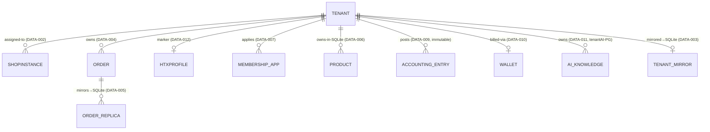

# Data Entity Map — P3

> Registry: `registries/data-entities.yaml` (12). SoT boundaries per SRS §8.3. `64789992`.

## Store boundary summary

| Store | Entities (SoT) | Replica/cache |
|---|---|---|
| Gateway PG | Tenant, ShopInstance, Order, AccountingEntry, HtxProfile, MembershipApp, Users, FeaturedProducts | — |
| Tenant SQLite | **Products** (only home), POS/kitchen state | Order replica, Tenant mirror, loyalty mirror |
| Metering DB | Wallet, top-ups, usage, rate cards | — |
| vanan-ai PG+pgvector | Knowledge docs, chunks/embeddings, chat sessions | — |

## Notes

- Products are **tenant-private** — never synced to PG (Option C); Gateway serves `/api/catalog/*` from FeaturedProducts+history (PG) while `/api/products/*` forwards to tenant SQLite (discrepancy D3 documented).
- `AccountingEntry` append-only; corrections = reversal entries (CTRL-001).
- FK integrity: business keys = PK (`Id == BusinessKey.Value` single-identity pattern, per governance).
